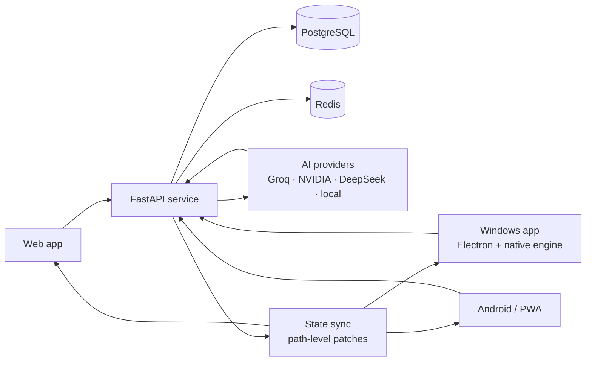

# Amookht · آموخت


**A self-hosted German-learning platform for TestDaF and ÖSD** — one backend serving a web app, a Windows desktop app and an Android build.

Amookht builds a six-category daily study plan (Hören, Lesen, Schreiben, Sprechen, Grammatik & Wortschatz, Wiederholung), corrects written answers with AI, feeds mistakes into a spaced-repetition notebook, and keeps progress in sync across every device.

---

## Live version

The current, actively running version is **learn.tah3in.com**: frontend in the repository root plus `backend/`, the conversation coach in `coach/`, and the Windows app in `apps/windows/`. Earlier versions remain in the git history.

- Large audio assets (`assets/free-audio`, `assets/method-audio`, `sim-audio`, `osd-sim/audio`), installers, user data and keys are **not** in git.
- Windows installer: `https://learn.tah3in.com/downloads/Amookht-Setup.exe` (auto-update via `latest.yml`).

## One product, three clients

| Part | Path | Description |
| --- | --- | --- |
| **Web app** | repository root (`testdaf-daily-plan.html`, `backend/`, `coach/`) | FastAPI + PostgreSQL + Redis with a build-free frontend |
| **Windows app** | [`apps/windows/`](apps/windows/README.md) · [`docs/windows/`](docs/windows/README.md) | Electron 32, native engine, desktop widget, auto-update |
| **Android** | [`docs/android.md`](docs/android.md) | WebView / PWA on the same API |

## How it fits together



## Documentation

### Server (web app + API)

- [Overview and API index](docs/server/README.md)
- [Architecture, layers, state sync](docs/server/architecture.md)
- [AI: provider registry, fallbacks, cost](docs/server/ai.md)
- [Content generation and anti-repetition](docs/server/content.md)
- [Security](docs/server/security.md)
- [Tests, known issues and fixes](docs/server/testing.md)
- [Deployment, isolated environment, updates](docs/server/deploy.md)

### Windows app

- [Overview](docs/windows/README.md)
- [Electron architecture and native engine](docs/windows/architecture.md)
- [Manual content packs (4.1.0)](docs/windows/owner-packs.md)
- [Build, release and auto-update](docs/windows/build-and-update.md)
- [Security and tests](docs/windows/security-and-tests.md)
- [Changelog](docs/windows/changelog.md)

---

## Quick start (server)

```bash
git clone https://github.com/s-mostafaahmadi/amookht.git amookht && cd amookht/backend
python3 -m venv .venv && .venv/bin/pip install -e .
cp .env.example .env            # SECRET_KEY, DATABASE_URL, REDIS_URL, AI keys
.venv/bin/uvicorn app.main:app --reload --port 8200
```

Serve `index.html` and `testdaf-daily-plan.html` with nginx or `python -m http.server`.
Full guide and isolated environment: [docs/server/deploy.md](docs/server/deploy.md).

## Quick start (Windows app)

```powershell
npm install
npm start          # run
npm run dist       # build installer -> dist/Amookht-Setup-<ver>.exe
```

## Key features

- **Adaptive daily plan** — six exercise categories, 60–300 minute sessions, weekly focus, learning phase, exam mode.
- **Resilient AI layer** — multiple providers (Groq, NVIDIA, DeepSeek, local), circuit breaker, daily quota, encrypted keys, SSRF protection.
- **Writing correction and speech analysis** — per-criterion scoring, mistakes recorded in the notebook, four-level SRS.
- **Realtime sync** — path-level state patches between web, Windows and mobile.
- **Content anti-repetition** — used-set tracking, re-selection up to 12 times, content store with unique keys.
- **Owner tooling** — file-day store, runnable content packs (`/v1/owner-packs`), AI panel, admin chat.
- **Security** — JWT + bcrypt, per-user/per-IP rate limits, roles, systemd hardening, `_gate` lock.

## Repository layout

```
├── index.html                    # landing page
├── testdaf-daily-plan.html       # the study runner (core of the product)
├── mobile.html / android.html    # mobile / Android builds
├── backend/                      # FastAPI (app/, tests/, alembic/, pyproject.toml)
├── docker-compose.yml            # local Postgres / Redis / API
├── vendor/                       # local libraries (pdf.js)
└── docs/
    ├── server/                   # server documentation
    ├── windows/                  # Windows app documentation
    └── android.md                # Android build notes
```

## Project status

- Windows app: **4.5.0**
- Backend: FastAPI 0.110+, Python 3.11
- License: [MIT](LICENSE) — free reuse with attribution.

## License

Released under the [MIT License](LICENSE).
